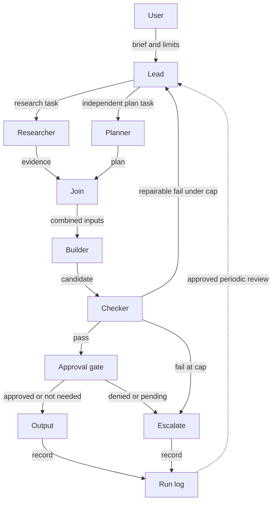

# Agent contract and graph

Each role specifies id, reports_to, purpose, input schema, output schema, non_goals, allowed_tools, prohibited_actions, 3–5 done_well checks, and handoff_to. Example: Researcher receives question and approved scope; returns claim/source/date/uncertainty records to Lead; does not publish, access secrets or make the final decision.

Plain flow: User → Lead → independent Researcher and Planner → Join → Builder → Checker → Approval gate → Output. A repairable failure returns to Lead no more than twice. Pending approval pauses; denial cancels; exhausted repairs escalate. Join and Builder are Lead-managed handoffs. Adapt the topology to actual dependencies.

State envelope: run_id, job, constraints, role_outputs, evidence, repair_count, max_repairs, review (score, verdict, blockers, fixes and responsible roles), approval (status, action, payload_digest, approved_by), status and errors. Terminal states include completed, failed, cancelled, awaiting_approval. Validate messages at boundaries. Use run IDs, avoid cross-run leakage, use idempotency for external writes and redact logs. Missing evidence or approval is a blocker.
