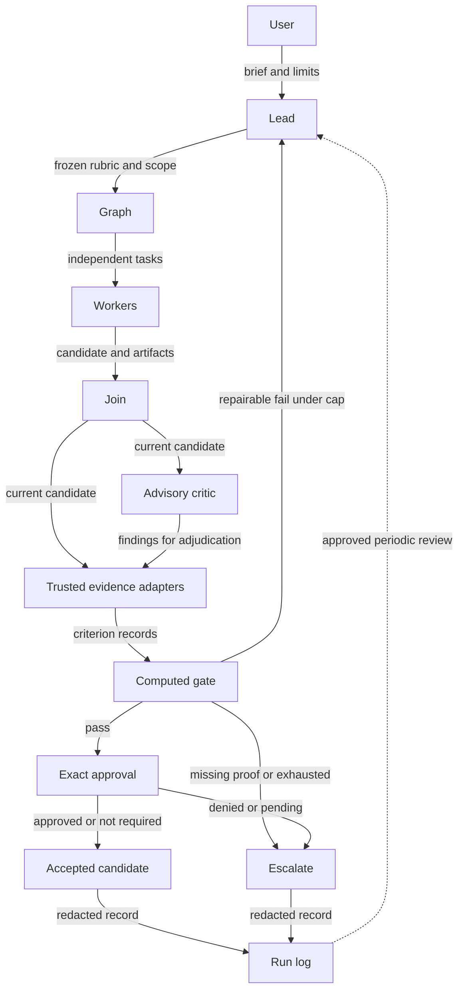

# Agent contract and graph

Each role specifies id, reports_to, purpose, input/output schema, non_goals, allowed_tools, prohibited_actions, 3–5 done_well checks, and handoff_to. Example: Researcher receives a question and approved scope; returns claim/source/date/uncertainty records to Lead; cannot publish or set the final score.

Plain flow: user → Lead → frozen rubric and task graph → workers → join → evidence adapters and critic → computed gate → exact approval → accepted candidate. Failed criteria can be routed back twice at most. Unknown evidence escalates. Pending approval pauses; denial cancels. For real tasks an advisory finding needs adjudication; the reference callback cannot override a verifier. Make the decisive reviewer a declared criterion when needed.

Keep distinct: worker output (untrusted), verifier observation (trusted only through the host), subjective judgement (labelled), accepted candidate, approval request and actual external action receipt. State envelope: run_id, pinned task, criterion definitions and source identities, worker outputs, evidence, rounds, review (scores, coverage, range, verdict, blockers, fixes), approval (run_id, action, payload, candidate, approver), status and errors. Do not put credentials in state. Validate boundaries and give agents least privilege. Use unique run IDs, actual authenticated consent, durable replay protection, idempotency and cancellation when building a side-effecting adapter. In the reference runner the approval comparison is an exact in-memory JSON comparison, not cryptographic authentication or actual action execution.
